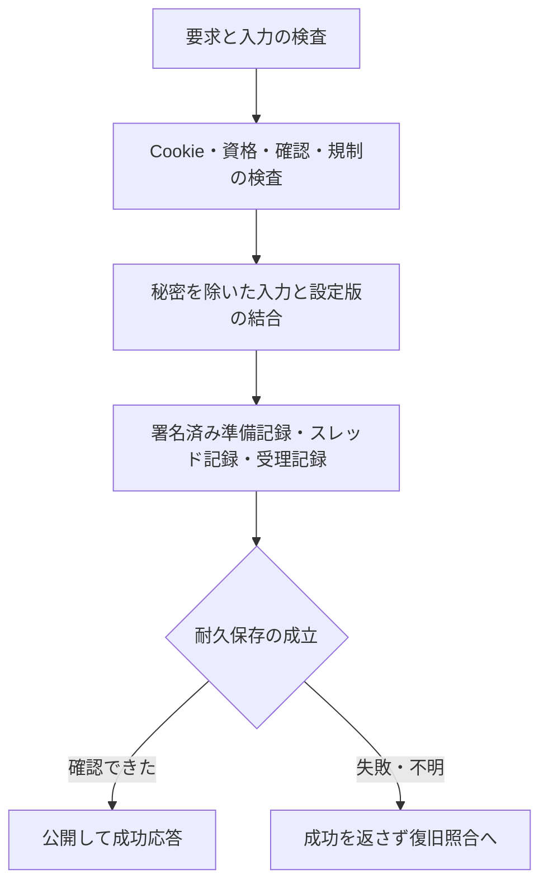

# 内部設計

保存・実行・配信の設計です。機能は[確定仕様](specification.md)、保存形式の試験データは[fixture](design/fixtures/)を参照してください。

## 構成

| 層 | 責務・主な実装 |
| --- | --- |
| CLIと起動 | `cmd/oimobbs`。初期化、検査、管理、停止、公開起動 |
| アプリケーション | `internal/bootstrap`。サイト・板・投稿・管理・期限と保存の接続 |
| 投稿実行 | `internal/board`、`internal/app`。板の処理列、保存と再送 |
| 入力と表示 | `internal/postinput`、`internal/postcapture`、`internal/identity`、`internal/textcodec` |
| 保存 | `internal/store`。WAL、current、pack、control snapshot |
| HTTP | `internal/compat`、`internal/webui`。DAT・CGI・Web・管理HTML |
| 資源管理 | `internal/delivery`、`internal/platform`。送信予算、生成・接続・所有排他 |
| 認証・規制 | `internal/adminauth`、`internal/abuse` |
| 非公開記録 | `internal/evidence`、`internal/disclosure`。署名・保全・提出 |

サイトの保存先にはサイトID、用途別の永続鍵、板管理、投稿WAL、制御記録、署名journalを保存します。公開・管理の待受は別に確保し、両方の準備ができてから起動結果を返します。同じ保存先の同時所有をLinuxの排他で拒否し、ファイル種別・所有者・権限を検査します。

## 用語と版の区別

| 用語 | 役割 |
| --- | --- |
| WAL | 投稿・操作を順に追記する記録。再起動時に確定状態を照合します |
| current | 現在読む保存世代と必要なWAL位置を指す参照 |
| pack | 整理・圧縮した保存本体。公開DATそのものの圧縮応答とは別です |
| control snapshot | 管理設定などの現在値と監査境界をまとめた保存 |
| 署名journal | 投稿・処理・監査の記録を署名と連鎖で結び付けた記録 |
| 保存世代 | 保存配置を区別する番号。整理で進む場合があります |
| 業務revision | 投稿や管理操作による状態変更を区別する番号 |
| DAT世代 | 公開本文の版。既存行の置換後に古い差分を継ぎ足させないためにも使います |

保存整理だけでは、公開本文・DAT世代・対応するETagを変えません。

## 投稿の確定

### 確定の順序

要求はHost/TLS、Origin/Referer、Fetch Metadata、本文上限、フォーム、Cookie、資格、確認、規制の順序に従って検査します。名前・メールに含む認証秘密を除去し、正規化した入力と設定版から要求HMAC、本文/DAT/frameのhashを生成します。

保存はproposal、スレッド記録、acceptedの署名記録を結合します。耐久保存を確認した後に公開し、成功を返します。保存失敗・結果不明を成功へ置き換えません。再起動は署名記録・WAL・設定版・入力と出力のhashを照合し、未確定の操作を裁定します。

板の処理列で順序を守ります。同じスレッドの到着済み返信は最大16件までまとめて同期できます。待機時間を追加して投稿を集めたり、先行操作を追い越したりしません。管理操作との境界を維持します。

明示要求IDは本文・主体・投稿先と束縛して照合します。同じIDの内容変更は拒否し、受理済み再送は同じ結果を返します。CAP管理操作は明示IDで24時間、IDなしで30秒の再送を扱い、接続IP変更を新しい操作の理由にしません。

## 保存形式と復旧

JSONは厳密なUTF-8で、重複・未知項目・型違い・必須項目欠落を拒否します。未使用のnullと空配列を区別します。サイト形式schema2と最低reader版を検査し、未対応の形式を推測で読みません。

WALは長さ付きフレーム、CRC32C、明示的なlittle endian符号化を使います。投稿内容・DAT・操作状態を結合し、途中末尾・破損・必要位置の欠落を区別します。CRCは偶発破損の検出であり、署名認証の代用にしません。

`current` は保存世代・base・必要なWAL位置を参照します。同期済みの新世代を作成し、参照を切り替えてから旧世代を検証付きで回収します。圧縮packは独立実装のZstandardを使います。保存世代、業務revision、DAT世代は別で、圧縮だけで公開本文・DAT世代・ETagを変えません。

control snapshotは現在値と監査境界を保存し、通常WALの遷移検証とは分けて照合します。監査の日別末尾・署名連鎖を検査し、欠落や古い記録への差替えを拒否します。ローカル照合は外部時刻や保存先全体の巻戻りを証明するものではありません。

初回スレッド保存途中の停止では、署名済み要求と完全WALが揃った場合だけcurrentを補完します。欠落・矛盾を新しい要求として作り直したり、壊れた保存先を自動初期化したりしません。

## 削除と期限回収

### 公開停止から回収まで

削除は先行intent、公開停止、スレッドへの反映、回収の順で進めます。intentを確認して公開ゲートを閉じるため、途中で停止しても再起動で旧本文を再公開しません。レス削除は番号を維持し、対象範囲と操作IDを固定します。

公開本文、キャッシュ、WAL/packの旧世代、通常バックアップ、非公開の受理原本、案件保全を別々に管理します。公開削除は原本保管の期限を短縮しません。監査引渡しや原本照合が未完了なら、必要な本体を先に回収しません。

期限は保存済みの値を使います。再送・再起動・閲覧で延ばさず、期限切れの本文をバックアップから公開復元しません。復元は最新台帳を正とし、古いバックアップは欠落した本文の補充に限定します。

## 配信と資源

公開snapshotと送信リースを使い、削除・期限・版変更を送信時にも検査します。同じ版のDATは同じETagを返し、既存行を置き換えた版への差分再開は拒否して全文へ戻します。圧縮結果にも同じ版と期限を適用します。

本文・推定ヘッダ・通信分の見積もりへ共通送信予算を適用します。バーストは帯域2ms分、最低32KiBです。TLS前の接続制限、HTTP/2とヘッダ・時間・同時生成の上限を使います。容量不足・保存不確定で新規投稿を止め、到着済みの既受理再送を新規投稿として消費しません。

HTML生成と圧縮は有界に実行し、キャッシュはLRUで回収します。稼働設定は同期保存後にimmutable値として公開し、帯域変更で追加バーストを付与しません。整理条件は次のバッチから反映し、書込み中の処理を時間予算で中断しません。

## 管理・非公開情報

管理接続は通常、同じ公開HTTPSの管理パスです。公開入口構成でも管理要求をmTLS認証と利用者接続元の確定に通し、IP制限・認証・管理専用要求枠へ渡します。管理要求は公開側のHTTP観測より前に分岐し、管理専用の要求枠と認証へ渡します。全応答に検索抑止を付け、robotsと既知クローラー拒否を認証前に適用します。管理パスでは公開側のTLS・接続・HTTP/2上限を共用します。別待受のdirect_httpsはTLS前に全体64・接続元8、HTTP/2同時16streamです。認証前にも経路とFetch Metadataを検査します。変更は認証、担当板、追加権限、再認証、CSRF、版の比較、再送キーを検査し、同期保存後に公開します。

接続記録は直近hopの観測と利用者側の情報を区別します。直結接続ではpeerのIP・ポートを使います。mTLS終端は認証済みの専用ヘッダだけを採用し、転送情報の欠落・重複・矛盾を拒否します。申告UAやOriginを本人確認済み情報へ昇格しません。

秘密除去済み入力・観測値・HMAC・署名journalを結合し、Ed25519の署名と連鎖を検査します。未観測の値を現在のbuild・設定から補完しません。保全・抽出・提出・受け渡しには先行監査と現在権限の検査を使い、ストリーム中も期限・権限を確認します。

## 検証用データ

`docs/design/fixtures/` は架空の鍵・IP・投稿を使った保存形式とHTTP判断の合成データです。旧形式は対応・拒否境界の検査に使います。

具体的なバイト配置は `internal/store`、業務型は `internal/domain` と `internal/bootstrap`、秘密除去と投稿照合は `internal/postcapture` の型・検証器を参照します。変更時は独立した既知値と拒否例を更新し、実装から期待値を生成しません。
