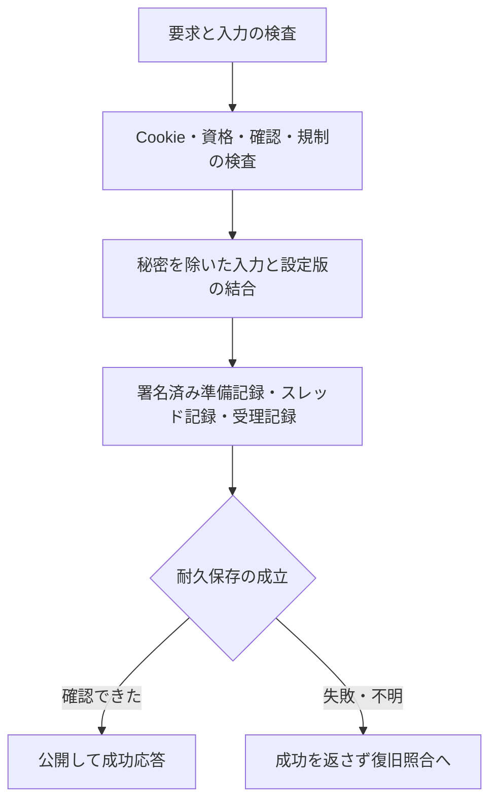

# 内部設計

保存・実行・配信の設計です。機能は[仕様の全体像](specification.md)、保存形式の試験データは[fixture](design/fixtures/)を参照してください。

## 読む順序

| 調べたいこと | 節 |
| --- | --- |
| 実装の分担と用語 | [構成](#構成)・[用語と版](#用語と版の区別) |
| 成功応答を返すまでの順序 | [投稿の確定](#投稿の確定) |
| バッチ保存・再送・取消 | [返信の一括保存](#返信をまとめて保存する)・[再送照合](#再送を照合する) |
| WAL・snapshot・署名の検証 | [保存形式と復旧](#保存形式と復旧) |
| 何を圧縮するか | [圧縮範囲](#ログ関連の圧縮範囲) |
| 削除途中で停止した場合 | [削除と期限回収](#削除と期限回収) |
| 配信中の条件変更・過負荷 | [配信と資源](#配信と資源) |
| 管理と非公開記録の境界 | [管理・非公開情報](#管理非公開情報) |

## 構成

| 層 | 責務・主な実装 |
| --- | --- |
| CLIと起動 | `cmd/oimobbs`。初期化、検査、管理、停止、公開起動 |
| アプリケーション | `internal/bootstrap`。サイト・板・投稿・管理・期限と保存の接続 |
| 投稿実行 | `internal/board`、`internal/app`。板の処理列、保存と再送 |
| 入力と表示 | `internal/postinput`、`internal/postcapture`、`internal/identity`、`internal/textcodec` |
| 保存 | `internal/store`。WAL、current、pack、control snapshot |
| HTTP | `internal/compat`、`internal/webui`。DAT・CGI・Web・管理HTML |
| 資源管理 | `internal/delivery`、`internal/platform`。送信予算、生成・接続・所有排他 |
| 認証・規制 | `internal/adminauth`、`internal/abuse` |
| 非公開記録 | `internal/evidence`、`internal/disclosure`。署名・保全・提出 |

サイトの保存先にはサイトID、用途別の永続鍵、板管理、投稿WAL、制御記録、署名journalを保存します。同じ保存先の同時所有をLinuxの排他で拒否し、ファイル種別・所有者・権限を検査します。

通常の管理画面は、公開HTTPSと同じ待受の管理パスに登録します。別待受方式では公開用・管理用を別に確保します。必要な待受の準備ができてから起動結果を返します。

## 用語と版の区別

| 用語 | 役割 |
| --- | --- |
| WAL | 投稿・操作を順に追記する記録。再起動時に確定状態を照合します |
| current | 現在読む保存世代と必要なWAL位置を指す参照 |
| pack | 整理・圧縮した保存本体。公開DATそのものの圧縮応答とは別です |
| control snapshot | 管理設定などの現在値と監査境界をまとめた保存 |
| 署名journal | 投稿・処理・監査の記録を署名と連鎖で結び付けた記録 |
| 保存世代 | 保存配置を区別する番号。整理で進む場合があります |
| 業務revision | 投稿や管理操作による状態変更を区別する番号 |
| DAT世代 | 公開本文の版。既存行の置換後に古い差分を継ぎ足させないためにも使います |

保存整理だけでは、公開本文・DAT世代・対応するETagを変えません。

## 投稿の確定

### 確定の順序

要求はHost/TLS、Origin/Referer、Fetch Metadata、本文上限、フォーム、Cookie、資格、確認、規制の順序に従って検査します。名前・メールに含む認証秘密を除去し、正規化した入力と設定版から要求HMAC、本文/DAT/frameのhashを生成します。

専ブラの `/test/bbs.cgi` とWeb投稿は、Cookie使用と現行の利用規約への同意を一度求めます。同意Cookieはサイトと規約版へ署名で結び付け、本文・板・IPには結び付けません。同意Cookieの有効期間は1年です。管理画面でCookie説明または規約本文を変更すると規約版と変更日時を自動更新し、次回投稿で再同意を求めます。変更日はJSTで表示し、同文保存では変更しません。匿名Cookieの検証・発行制限、公開条件の検査、Webの同一Origin・CSRF検証も適用します。

保存はproposal、スレッド記録、acceptedの署名記録を結合します。耐久保存を確認した後に公開し、成功を返します。保存失敗・結果不明を成功へ置き換えません。再起動は署名記録・WAL・設定版・入力と出力のhashを照合し、未確定の操作を裁定します。

### 投稿受付と資源上限

公開受付開始前に `posting_resources:active` へ切り替え時刻を同期保存し、最低reader90を宣言します。境界以降の投稿では、旧来のサイト全体200件/秒・ネットワーク全体60件/秒の固定枠を消費しません。WAFの設定可能な頻度・同時処理、板の有界列、メモリ・保存容量の予約を使います。IP・Cookieの間隔制限と条件規制は維持します。復旧時は各投稿の確定時刻と保存境界で条件を選び、境界以前の履歴は元の固定枠でも検査します。

### 返信をまとめて保存する

同じ板・日別journalを使う到着済み返信は、複数スレッドを含め最大64件・符号化予算8MiBまでまとめます。板の所有ワーカーが処理順序を管理し、次の順序で保存します。

1. 共有するproposal（準備記録）を同期します。
2. 候補のメモリ予約を保持したまま、独立したスレッドWALを並行同期します。並列数は `min(スレッド数, max(16, GOMAXPROCS×2))` です。
3. 全WALの同期完了後、共有するdecision（確定記録）を同期します。
4. 三つの保存境界が成立した後に各スレッドを公開し、成功を返します。

所有ワーカーは並行同期が終わるまで次の操作へ進みません。同期専用goroutineは担当WALだけを操作します。保存開始前の取消は候補を破棄します。保存開始後に結果が不明になった場合は、関係する全スレッドの書込みと公開を止め、再起動時に照合します。

proposal・decisionのpayload検証は、同じ所有ワーカー内で最大 `min(GOMAXPROCS, 件数)` 枠へ分担します。入力を生成するcallbackは要求順に呼び、元byteを複製してから検査へ渡します。全検査の終了後に要求順でエラーを確認し、署名連鎖と保存frameを作ります。外部から渡されたcapture検査器は直列呼出しを保ちます。1件またはCPU並列数1では従来の直列経路を使います。

次の連番の検証には、各スレッドの最新候補だけを保持します。個々のframe・再送情報・証跡proposalは確定まで保持し、各frameを保存層でも再検証します。

### 確認要求と収集待ち

確認だけの群はすぐに返します。保存候補がある群だけ、後続の到着を待つ時間を合計2msまで許可します。途中で到着した未保存の確認要求もすぐ実行し、クライアントの次の往復へ返します。通常操作とのFIFO、64件上限、管理操作との境界を維持します。

### 再送を照合する

確定済み履歴のkey索引を使い、追記分だけを索引へ加えます。同じkeyでは最初の期限内記録を選びます。明示IDの本文不一致も元記録と照合して拒否します。packで期限切れの再送情報を除くときは、索引のHMACも同じ境界で破棄します。

明示要求IDは本文・主体・投稿先と束縛して照合します。同じIDの内容変更は拒否し、受理済み再送は同じ結果を返します。CAP管理操作は明示IDで24時間、IDなしで30秒の再送を扱い、接続IP変更を新しい操作の理由にしません。

## 保存形式と復旧

JSONは厳密なUTF-8で、重複・未知項目・型違い・必須項目欠落を拒否します。未使用のnullと空配列を区別します。サイト形式schema2と最低reader版を検査し、未対応の形式を推測で読みません。

WALは長さ付きフレーム、CRC32C、明示的なlittle endian符号化を使います。投稿内容・DAT・操作状態を結合し、途中末尾・破損・必要位置の欠落を区別します。CRCは偶発破損の検出であり、署名認証の代用にしません。

`current` は保存世代・base・必要なWAL位置を参照します。同期済みの新世代を作成し、参照を切り替えてから旧世代を検証付きで回収します。圧縮packは独立実装のZstandardを使います。保存世代、業務revision、DAT世代は別で、圧縮だけで公開本文・DAT世代・ETagを変えません。

Webスレッド閲覧とDAT取得は対象板を直接解決し、全板一覧用のサイトJSON復号・カテゴリー集計・並べ替えを通しません。閲覧許可・非表示板・公開リースの検査は各要求で行います。

### 制御記録の検証と並列化

制御WALの一括追記では、8件以上・合計32KiB以上の場合だけ、状態に依存しないframe・JSONのデコードを `min(GOMAXPROCS, 件数/4)` 枠へ分担します。全デコードの終了後に、入力順でエラーを検査し、連番・CAS・値の検証・状態適用を所有列で行います。小さいバッチは追加goroutineを作りません。匿名情報の結合では、同じ呼出し内で完全型検証済みのcaptureを使い、JSONの再復号を省きます。

更新後の業務条件・符号化サイズ・frameとの対応は再検査し、外部入力や再起動時の検査結果へ持ち越しません。通常フォームの正規化とtrip生成も、不変の入力と用途鍵だけからHTTP側で準備します。停止・認可・最新設定・受理枠の検査は所有列に残し、バッチ再試行時も資格HMACを重ねません。

### WALとsnapshot

WALの保存形式はversion 2です。`OIMOWAL2` / `OIMOCTL2` のヘッダを使い、一つの圧縮blockに最大64件の正規フレームをZstandardでまとめます。通常の同期は最大64件のまま、非必須HTTP記録だけは既存blockを最大4個連結し、計256件を一度のWrite・Syncで保存できます。非必須記録は元JSONを4MiB以内、保存列全体を8MiB以内に制限し、byte上限で区切るときは64件のblock境界へ揃えます。圧縮器・探索精度・最小出力の選択を変えず、各blockの圧縮byteが単独保存時と一致することを試験します。

32KiB未満の単独フレームは、投稿の同期経路に圧縮処理を足さず、従来と同じ正規バイトを保存します。圧縮待ちの固定遅延は追加しません。圧縮前の合計は最大8MiB（単一の最大フレームは外枠20bytesを加算）で、展開長・CRC32C・終端・フレーム数を検査します。外枠込みで小さくならない場合は、version 2内の非圧縮保存を選びます。

正規フレームの `OIMOEND1` は署名対象の論理形式として維持し、圧縮保存外枠の `OIMOEND2` と区別します。署名・投稿要求のhashは圧縮前の正規フレームへ束縛し、currentの位置・hashは実際の保存バイトへ束縛します。

control snapshotは `OIMOCSN2` / `OIMOCBK2` を使い、最大2MiBのchunkごとにZstandardまたは非圧縮で保存します。全体64MiB、最大200,000行の上限とrevision・期限・値の照合を維持します。旧WALヘッダ・旧snapshot形式を通常起動で読む互換経路はありません。既存データの変換は、停止・退避したコピーに対する一度限りの処理で行います。

### メモリ上の記録と復旧照合

署名journalのメモリ上の索引では、同じpayloadの元byteとbase64を二重保持しません。非必須HTTP行は元byte、受理投稿の原本・決定と未受理接続記録は、投稿所有者とも共有できる不変base64を保持し、照会・走査・提出へ渡すときに完全なEntryを復元します。JSONの再符号化や再署名は行わず、署名対象の元byte、WAL形式、保存量の容量計算、保持期限を維持します。

投稿所有者も通常投稿のframe・captureを別々には保持せず、採番・再送照合用のmetadataと共有する署名済みpayloadを残します。原本を必要とする照会・pack・復旧では、元payloadのhashと保持metadataを照合して本文を独立復元します。回収済み原本は復元対象にせず、再起動時の全署名・完全スキーマ検査を維持します。

control snapshotは現在値と監査境界を保存し、通常WALの遷移検証とは分けて照合します。監査の日別末尾・署名連鎖を検査し、欠落や古い記録への差替えを拒否します。ローカル照合は外部時刻や保存先全体の巻戻りを証明するものではありません。

初回スレッド保存途中の停止では、署名済み要求と完全WALが揃った場合だけcurrentを補完します。欠落・矛盾を新しい要求として作り直したり、壊れた保存先を自動初期化したりしません。

### ログ関連の圧縮範囲

| 対象 | 圧縮方式・境界 |
| --- | --- |
| 投稿DAT・操作の追記WAL | 到着済みバッチと32KiB以上の単独記録はZstandard。小さい単独Syncと、圧縮で小さくならない列は非圧縮 |
| 必須投稿原本・非必須HTTP観測・監査・案件のjournal | 共通control WALのZstandard。署名・連鎖は圧縮前の記録に対して維持 |
| DAT packの本文・監査chunk | 既存の保存用Zstandard。圧縮候補と最小出力の選択規則を維持 |
| control snapshot | Zstandard。小さくならなければ非圧縮 |
| current、欠測カウンタ、鍵・小さな管理metadata | JSONまたは固定長データ。個別圧縮なし |
| 保存済みネットワーク分類表の内部値 | 署名対象JSON内のgzip/base64を維持。外側WAL・snapshotはZstandard |
| 提出用ZIP | ZIP標準のDeflate。外部で開く形式として維持 |
| Dockerの標準出力ログ | アプリケーションの保存WALとは別。Composeのjson-fileローテーションを使い、Zstandard化しない |
| HTTPの全文配信 | Accept-Encodingに応じたidentity・gzip・Zstandard |
| DAT差分（206） | identity。保存側の圧縮方式と独立した元DATのバイト位置 |

非必須HTTP記録の受付は最大4096件・予約JSON合計16MiBで有界にし、保存中の行も予約へ含めます。非必須HTTP記録は、実保存量と現在行の展開量を別々に制限します。日別64MiB・全日合計128MiBを圧縮後のディスク容量だけで広げず、snapshotの展開上限と保持する状態量を守ります。展開量は各署名値にsnapshot行の外枠上界192bytesを加算して計数し、再起動・回収後には検証済み現在行から再構成します。

保存用のlevel 1/6/9は独自圧縮器の探索方針であり、外部のZstandard CLIと同じ数値設定を意味しません。level 9は従来と同じ4候補を比較し、最小の候補だけを専有配列へコピーします。候補ごとの不要な返却配列確保を減らし、選ばれる圧縮バイト列を維持します。

## 削除と期限回収

### 公開停止から回収まで

削除は先行intent、公開停止、スレッドへの反映、回収の順で進めます。intentを確認して公開ゲートを閉じるため、途中で停止しても再起動で旧本文を再公開しません。レス削除は番号を維持し、対象範囲と操作IDを固定します。

公開本文、キャッシュ、WAL/packの旧世代、通常バックアップ、非公開の受理原本、案件保全を別々に管理します。通常の管理操作による公開削除は原本保管の期限を短縮しません。監査引渡しや原本照合が未完了なら、必要な本体を先に回収しません。

期限は保存済みの値を使います。再送・再起動・閲覧で延ばさず、期限切れの本文をバックアップから公開復元しません。復元は最新台帳を正とし、古いバックアップは欠落した本文の補充に限定します。

### 容量不足時の早期回収

公開起動では、writerの開始前に最低reader99を同期保存します。容量監視が対象を選び、案件・元予約の共通排他の下で、対象スレッドの全受理操作の両原本が保全対象でないことを確認します。候補と保全集合を確定した後はサイト排他を解放し、回収I/O中も別の板の処理を進めます。板の所有列が忙しい場合は延期します。

早期回収は、通常の `expire` と区別した `pressure` の削除予定を先に保存します。公開停止、署名付き公開回収証明、独立した再送・規制履歴の引継ぎ、公開本体の回収、管理監査の引渡しへ進みます。原本の回収は後続の周期で有界に進め、保存前にも両側の保全を確認します。

元の6暦月の期限は変更しません。原本の削除証跡には容量回収の理由を署名し、復旧時は対応する署名済み公開回収証明を要求します。通常の期限満了の検査を、容量回収のない記録に対して緩めません。対象・周期・容量基準は[記録と回収](features/records.md#容量不足時の自動回収)を参照してください。

## 配信と資源

公開snapshotと送信リースを使い、削除・期限・版変更を送信時にも検査します。同じ版のDATは同じETagを返し、既存行を置き換えた版への差分再開は拒否して全文へ戻します。圧縮結果にも同じ版と期限を適用します。

本文・推定ヘッダ・通信分の見積もりへ共通送信予算を適用します。バーストは帯域2ms分、最低32KiBです。TLS前の接続制限、HTTP/2とヘッダ・時間・同時生成の上限を使います。容量不足・保存不確定で新規投稿を止め、到着済みの既受理再送を新規投稿として消費しません。

HTML生成と圧縮は有界に実行し、キャッシュはLRUで回収します。稼働設定は同期保存後にimmutable値として公開し、帯域変更で追加バーストを付与しません。整理条件は次のバッチから反映し、書込み中の処理を時間予算で中断しません。

### 画面ごとのCSS・JavaScript

基本の文字・フォーム・テーマは `ui.css`、ナビゲーションの現在位置は `ui.js` で共有します。管理画面は `admin.css` と `admin.js`、公開画面は `public.css` を加え、それぞれのレイアウトを分離します。

各HTMLの `page-assets` 部品で、そのページが使うCSS・JavaScriptだけを指定します。認証、WAF、回線分類、国名と一覧検索、設定変更の確認などは専用ファイルです。板一覧は編集用の資産を読み込まず、ログイン・再認証だけで認証用資産を読み込みます。国名の補完は一覧検索より先、入力補助は設定変更の確認より先に実行します。JavaScriptが無効でも通常のフォームを送信できます。

資産はビルド時に埋め込み、内容のSHA-256を含むURLで配信します。公開用は成功した版付き応答だけを長期キャッシュします。管理画面のCSS・JavaScriptは、表示元ページを含む専用URLで配信し、HTMLと同じ `no-store` に統一します。表示元HTMLと同じハンドラーでセッション・役割・担当板・再認証・対象データの存在を確認し、実際のテンプレートの `admin-assets` に含まれるファイルだけを返します。本文の描画は省略しますが、ページの認可処理は省略しません。回線分類の集計は耐久行の版ごとに再利用し、取得中フラグは毎回現在値を返します。国・地域コードの候補も、不変の国別表を構築する時に一度だけ集計し、返却時は候補配列だけを複製します。監査・板・自動停止・削除依頼・提出用ログ・管理者の一覧では、同じ認可が終わった後、資産のために一覧を再収集しません。ページ送りの対象を調べる必要がある経路では元の検証を維持します。Refererやクライアントの自己申告だけで許可せず、表示元のすり替えでも別画面用の資産は取得できません。

管理側の旧URL・表示元のない別名URLは404です。公開側から管理用資産や管理用の専用URLを取得することもできません。ログイン画面の宣言に含まれる共通・認証用資産だけは認証前に取得でき、取得時にログインフォームやCSRF Cookieを再発行しません。HEAD・条件付き取得にも先に同じ認可を適用します。`TestAdminPageAssetsSameAuthorization` がHTMLとの役割・担当板・再認証・失効の一致を、`TestPageAssetIsolation` と `TestAdminAssetsBrowser` が対象画面の資産指定と実際の要求を検証します。

## 管理・非公開情報

### 管理接続と更新条件

管理接続は通常、同じ公開HTTPSの管理パスです。公開入口構成でも管理要求をmTLS認証と利用者接続元の確定に通し、IP制限・認証・管理専用要求枠へ渡します。管理要求は公開側のHTTP観測より前に分岐します。全応答に検索抑止を付け、robotsと既知クローラー拒否を認証前に適用します。管理パスでは公開側のTLS・接続・HTTP/2上限を共用します。

別待受のdirect_httpsはTLS前に全体64・接続元8、HTTP/2同時16streamです。認証前にも経路とFetch Metadataを検査します。変更は認証、担当板、追加権限、再認証、CSRF、版の比較、再送キーを検査し、同期保存後に公開します。

### 接続元と証跡

接続記録は直近hopの観測と利用者側の情報を区別します。直結接続ではpeerのIP・ポートを使います。mTLS終端は認証済みの専用ヘッダだけを採用し、転送情報の欠落・重複・矛盾を拒否します。申告UAやOriginを本人確認済み情報へ昇格しません。

秘密除去済み入力・観測値・HMAC・署名journalを結合し、Ed25519の署名と連鎖を検査します。未観測の値を現在のbuild・設定から補完しません。保全・ZIP作成・取得には先行監査と現在権限の検査を使い、ストリーム中も期限・権限を確認します。

## 検証用データ

`docs/design/fixtures/` は架空の鍵・IP・投稿を使った保存形式とHTTP判断の合成データです。旧形式は対応・拒否境界の検査に使います。

具体的なバイト配置は `internal/store`、業務型は `internal/domain` と `internal/bootstrap`、秘密除去と投稿照合は `internal/postcapture` の型・検証器を参照します。変更時は独立した既知値と拒否例を更新し、実装から期待値を生成しません。
