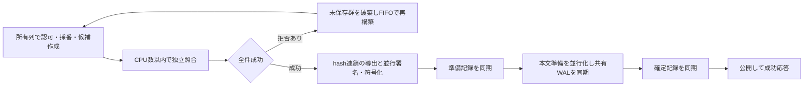

# 投稿処理のCPU・メモリ増設検証

2026-10-23に、板の所有列へ集中していた独立検証・署名・符号化・本文保存準備をCPU数に応じて分担しました。[集計と生記録のSHA-256](posting-resource-scaling.json)に、途中候補・失敗・未発行も含めて保存します。新規の隔離Docker volume上の実HTTPS測定であり、実サービスへの反映結果ではありません。

## 変更の境界

認可・規制・資格の有効性・採番・候補適用は板の所有列で順番に処理します。通常フォームでは構築時に完全検証したmetadataを同じ呼出し内で使い、元byteのHMAC・frameとの対応・HTTP観測元の照合を、保存前にCPU数以内のworkerへ分担します。全workerの終了前に予約を解放しません。一件でも検証が失敗すれば未保存群を破棄し、拒否した操作を除いてFIFOで再構築します。初回の日別journal作成とバッチ外の保存では先に検証します。

必須記録のhash連鎖は所有列で順番に計算し、その後の個別署名・frame符号化を並行化します。別スレッドの本文検証・圧縮も並行化します。各workerは自分の結果だけを作り、全成功を確認するまでfileを変更しません。最大64件・8MiBのバッチと既存のメモリ予約を維持し、1件またはCPU並列数1では追加workerを作りません。

標準サーバーは読み取り専用のcapture検証器を並行実行します。資格履歴の照合・更新には排他制御を加えました。独自の検証器を渡す起動APIは省略時に直列呼出しを保ち、`PostingOptions{ParallelCaptureValidation: true}` を明示する場合は入力・共有状態を変更しない契約が必要です。



準備記録→本文→確定記録→公開の順序と耐久同期は維持しています。板の所有列と三つの保存境界は残るため、全コアを常に使い切ったり、コア数に比例して一板の処理量が増えたりする保証はありません。

## CPU比較

同じ共有SATA SSD、80Mbps、16スレッド、80主体、専ブラ80%・Web20%、毎秒800投稿予定を10秒間です。メモリは4GiBへ固定し、測定中はビルド・テスト・プロファイルを実行しません。共有ホストの他処理による変動は残ります。

| CPU上限 | 変更前の時間内完了/秒 | 最終版の時間内完了/秒 | 最終版の平均CPU使用量 |
| --- | --- | --- | --- |
| 1 | 191.8 / 229.4 | 197.1 / 216.9 | 約1.00コア |
| 2 | 331.8 / 217.4 | 361.2 / 357.0 | 約1.60コア |
| 4 | 338.1 / 340.0 | 412.8 / 341.1 | 約2.12 / 1.86コア |

各数値は別試行です。変更前と途中候補はCPUごとにABBA順、最終版は1・2・4CPUを各2試行後、メモリ比較と変更前4CPUの追加試行（321.1投稿/秒・HTTP失敗なし）を行いました。変更前2CPUのばらつきが大きく、最終版4CPUにも約341〜413投稿/秒の幅があります。最終版4CPUの遅い試行はcgroup I/O待ちが約647ms、速い試行は約71msでした。ただし、この差だけで全変動の原因を断定しません。

2CPUへの増設では処理量の増加が確認できました。4CPUは2CPUを必ず上回る結果にはならず、単一板の順序処理と保存待ちが次の制約です。最大値だけから固定の改善率を示しません。

全条件で大量の未発行がある過負荷です。変更前1CPUにもHTTP失敗7／11件、最終版1CPUの一試行にも受理後のWeb遷移失敗2件があります。保存済み投稿はDATで照合しました。**毎秒800投稿を処理できた結果ではなく、安定運用の上限にも使いません。**

## メモリ比較

最終版4CPU、同じ毎秒800投稿予定・10秒の条件です。

| メモリ上限 | 時間内完了/秒 | HTTP失敗 | 最大メモリ |
| --- | --- | --- | --- |
| 1GiB | 387.7 / 379.6 | 71 / 152 | 約516 / 510MiB |
| 2GiB | 387.3 / 400.8 | 0 / 0 | 約517 / 522MiB |
| 4GiB | 412.8 / 341.1 | 0 / 0 | 約543 / 483MiB |

1GiBの失敗は、Webフォーム取得失敗48／84件、Web投稿の503が23／45件、専ブラ投稿の503が0／22件、受理後のWeb遷移失敗が0／1件でした。2GiBでは両試行ともHTTP失敗がなくなりました。いずれもOOM killはありません。最大メモリだけで受付余裕を評価せず、予約中の作業・拒否・未発行を分けます。2GiBから4GiBへの増量で処理速度が一貫して上がった証拠はありません。

GoのGC目標、保持量・生成数・検索並列数、投稿候補の予約は従来の[自動調整](../features/resources.md)へ従います。増設するだけでI/O速度や板の所有列が増えるわけではありません。

## 継続・混合・復旧

同じ16スレッド・80主体・80Mbpsで毎秒200投稿を60秒続け、正常再起動後に全DAT・ETagを照合しました。2GiBでは全件成功に届きませんでした。

| 版・CPU・メモリ | 成功 / 予定 | HTTP失敗 | 未発行 | 予定起点p95 | 再起動から全件照合 |
| --- | --- | --- | --- | --- | --- |
| 変更前・4CPU・2GiB | 11,584 / 12,000 | 322 | 94 | 約459.7ms | 約53.9秒 |
| 最終版・2CPU・2GiB | 11,856 / 12,000 | 115 | 29 | 約375.2ms | 約55.4秒 |
| 最終版・4CPU・2GiB | 11,641 / 12,000 | 266 | 93 | 約365.8ms | 約54.7秒 |
| 最終版・4CPU・4GiB | 11,907 / 12,000 | 0 | 93 | 約411.9ms | 約55.3秒 |
| 最終版・4CPU・2GiB・毎秒100投稿 | 6,000 / 6,000 | 0 | 0 | 約302.2ms | 約28.6秒 |

最終版4CPU・2GiBで毎秒100投稿を60秒続けた場合は6,000件全件成功、HTTP失敗・未発行なし、時間内完了100.0投稿/秒でした。最大メモリ約813.6MiB、予定起点p95は約302.2msで、250ms以内という基準は未達のため`stable_at_tested_rate`はfalseです。

継続試験は全DAT・ETag一致、応答済み投稿の欠落・重複なし、OOM killなしでした。4CPUへの増設だけで継続処理の失敗は解消せず、2CPUを必ず上回る結果にもなりませんでした。4GiBへの増量ではHTTP失敗がなくなりましたが、93件未発行、p95約411.9msが残り、毎秒200投稿の全件処理・250ms以内という基準は未達でした。2GiB・4GiBの毎秒200投稿を実用上限とは認定しません。

最終版4CPU・2GiB・WAF有効で、毎秒20投稿と通常閲覧200件/秒を4秒、閲覧2,000件/秒予定を12秒、通常閲覧へ戻す5秒の混合試験も実施しました。ピーク中は別一時ファイルへ64KiBを毎秒200回同期予定とし、2,086回完了しました。計画2,400回を全て供給できた試験ではありません。

- 投稿420/420件と追加200/200件が成功し、未発行・HTTP失敗・応答済み欠落・重複・不正本文・旧版prefix破損はありませんでした。
- 通常閲覧は800/800件成功。通常投稿の予定起点p95は専ブラ約15.8ms、Web約27.2msでした。
- ピーク閲覧は24,000件予定に対して3,245件を発行し、20,755件は未発行でした。発行分のHTTP失敗はありません。毎秒2,000閲覧を処理できた結果ではありません。ピーク投稿の予定起点p95は専ブラ約658ms、Web約1.23秒で、低遅延を維持した結果でもありません。
- ピーク後の最初の1秒は閲覧50件が未発行となり、次の4秒は各200/200件成功でした。投稿は全件成功ですが、ピーク後5秒のWeb投稿p95は約1.57秒でした。
- 最大メモリは約435.5MiB、OOM killなし。事前に1,000投稿の成功応答後にSIGKILLし、同一volumeで再起動したDAT・ETagも一致しました。停止から照合完了まで約5.34秒で、5秒目標には届きませんでした。

これらは合成入力・隔離HTTP・短時間の結果です。実機の電源断、媒体故障、WAN・実NIC、長期運用、実データの大きな履歴や本番への切替を実証したものではありません。

## 検査

新規検査はCPU workerの上限・全件join・入力順の拒否反映、保存前のHMAC改変拒否と再送、未保存群のFIFO再構築、直列版と並行版の署名・保存byte一致、外部検証器の直列／並行契約、通常フォームの両起動モードでの再起動を対象にします。

独立準備を並行化した段階でbootstrap親試験862件を8分割した全区分と、その他製品・ツールパッケージの全通常試験、関連するrace検査、`go vet`を通過しました。最終の標準検証器並行化後にも投稿・資格・規制・再送・復旧・バックアップを含む関連race検査を行っています。資格付き8件の同時フォーム投稿では重複のない採番と資格履歴を確認し、同じ並行検証モードでの正本復旧も検査しました。全パッケージの全race実行や実機電源断・媒体故障の実証ではありません。

## 再現手順

測定イメージを作った後、ビルド・検査・プロファイルを止めて実行します。CPU比較では`--cpus`だけを1・2・4へ、メモリ比較では4CPUへ固定して`--memory`だけを1g・2g・4gへ変えます。

```sh
python3 scripts/probe-thread-resources.py \
  --image oimobbs:scaling-parallel-capture-20261023 \
  --cpus 4 --memory 4g \
  --posting-capacity-rate 800 --posting-capacity-seconds 10 \
  --posting-capacity-workers 80 --posting-capacity-threads 16 \
  --output var/resource-scaling-overload.json
```

継続試験は`--posting-capacity-rate 200 --posting-capacity-seconds 60 --posting-capacity-restart`へ変えます。終了コード0だけで安定処理と判断せず、`summary`の失敗・未発行、`stable_at_tested_rate`、全DAT・ETag、OOM、再起動時間を確認してください。
